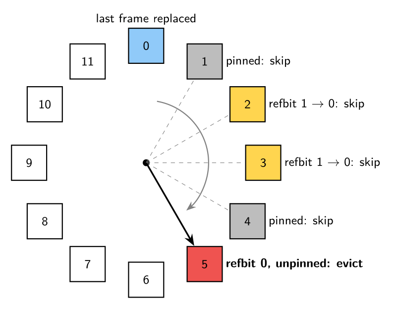
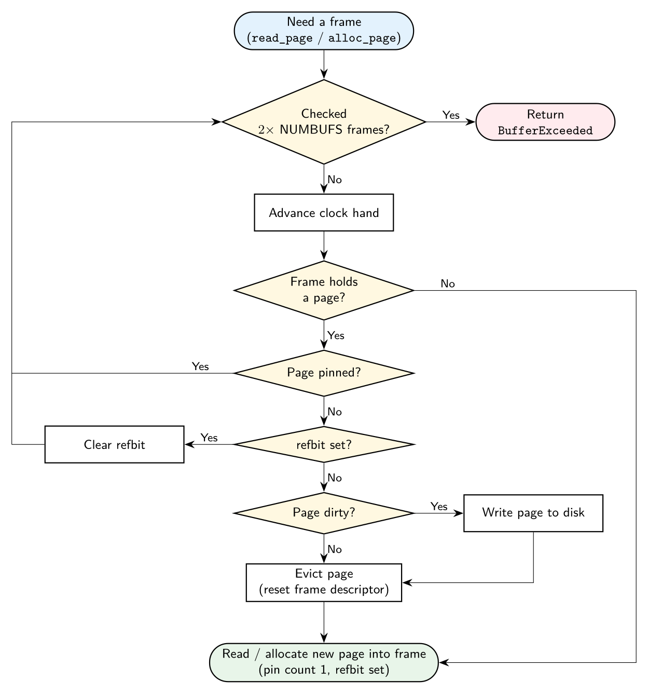

# Assignment 3: Buffer Manager

This writeup is written as a Markdown file. Most code editors (e.g., VSCode, CLion) will natively support Markdown previewing. To view it on VSCode, press Cmd + Shift + P on Mac or Ctrl + Shift + P on Windows and type "Markdown: Open as Preview" into the search bar. It should then open a window that lets you view the writeup in a more readable format. Alternatively, we have a PDF version of the writeup in assets/writeup.pdf.

In the last two assignments you learned about data models and query languages — the format in which you give the database your data, and the mechanism by which you can ask for it again later. The next two assignments will teach you about database storage and query execution.

You are allowed to use AI tools (e.g., ChatGPT, Claude, Gemini) for this assignment. After the assignment is due, there will be a short oral examination with a TA on your code. Additionally, in the benchmarking report (more details below), you must include an AI use disclosure statement that states whether you used AI, and if so, in what ways.

## Overview

In this assignment, you will implement two buffer managers with different replacement policies. A database buffer pool is an array of fixed-size memory buffers called frames that are used to hold database pages (also called disk blocks) that have been read from disk into memory. A page is the unit of transfer between the disk and the buffer pool residing in main memory. Most modern database systems use a page size of at least 8,192 bytes. Another important thing to note is that a database page in memory is an exact copy of the corresponding page on disk when it is first read in. Once a page has been read from disk to the buffer pool, the DBMS software can update information stored on the page, causing the copy in the buffer pool to be different from the copy on disk. Such pages are termed “dirty”.

Since the database on disk itself is usually about 100 times larger than the amount of main memory available on a machine, only a subset of the database pages can fit in memory at any given time. The buffer manager is used to control which pages are memory resident. Whenever the buffer manager receives a request for a data page, the buffer manager must check to see whether the requested page is already in one of the frames that constitute the buffer pool. If so, the buffer manager simply returns a pointer to the page. If not, the buffer manager frees a frame (possibly by writing to disk the page it contains if the page is dirty) and then reads in the requested page from disk into the frame that has been freed.

## Buffer Replacement Policies

There are many ways of deciding which page to replace when a free frame is needed. Commonly used policies in operating systems are FIFO, MRU and LRU. In this assignment you will implement the least recently used (LRU) and clock replacement policies.

### LRU Replacement Policy

The least recently used (LRU) replacement policy evicts the page that has gone the longest without being used. The intuition behind the LRU policy is that if a page has been used recently, it is likely to be used again soon. On the other hand, if a page is unused for a long time, it will probably not be used again soon. To implement the LRU policy, the buffer manager should keep the unpinned pages in the order of when they were last used (unpinned). When a free frame is needed, the least recently used page is evicted. If the selected buffer frame is dirty (i.e. it has been modified), the page currently occupying the frame is written back to disk. Then the frame's metadata is reset, and the new page is read into that frame.

### Clock Replacement Policy

Even though LRU is one of the most commonly used policies, it has high overhead and is not the best strategy to use in a number of common cases that occur in database systems. Instead, many systems use the clock algorithm that approximates LRU behavior and is much faster.

Figure 1 illustrates the execution of the clock algorithm. Each square box corresponds to a frame in the buffer pool. Assume that the buffer pool contains NUMBUFS frames, numbered 0 to NUMBUFS-1. Conceptually, all the frames in the buffer pool are arranged in a circular list. Associated with each frame is a bit termed the refbit. Each time a page is brought into or accessed in the buffer pool (via a `read_page()` or `alloc_page()` call to the buffer manager), the refbit of the corresponding frame is set to true. When a frame is needed, the clock hand (an integer whose value is between 0 and NUMBUFS - 1) is advanced one frame at a time in a clockwise fashion (using modular arithmetic so that it does not go past NUMBUFS - 1), and each frame it reaches is examined. If the frame is empty, it is used right away. If the frame holds a pinned page, it is skipped and its refbit is left unchanged; a pinned page is never replaced. If the page is unpinned and its refbit is set, the frame has been referenced "recently": its refbit is cleared and the page is not replaced. If the page is unpinned and its refbit is false, the page is selected for replacement. If every frame is pinned, nothing can be replaced, so after two full sweeps the clock stops and returns `BufferExceeded`. If the selected buffer frame is dirty (i.e. it has been modified), the page currently occupying the frame is written back to disk. Then the frame's metadata is reset, and the new page is read into that frame. Figure 2 gives the details of the algorithm.



*Figure 1: One sweep of the clock hand. Starting after the last frame replaced, the hand skips pinned frames, clears set refbits, and evicts the first unpinned frame whose refbit is 0.*



*Figure 2: The clock replacement algorithm.*

## Assignment Overview

In this assignment you will:
1. (25 points) Implement a buffer manager that uses the LRU replacement policy
2. (25 points) Implement a buffer manager that uses the clock replacement policy
3. (30 points) Benchmark your two implementations on two different workloads, and write a short report describing your benchmarks, why you chose them, and your results
4. (20 points) Complete a short oral examination with a TA on your code

The assignment is worth 100 points in total.


### Implementation Details

Both buffer manager classes (`LRUBufferManager` and `ClockBufferManager`) are derived from the base `BufferManager` class. The `BufferManager` class header, [src/include/buffer_manager.h](src/include/buffer_manager.h), contains the specifications for the five functions you should implement for each of the derived classes. These functions are `read_page`, `unpin_page`, `alloc_page`, `flush_file`, and `dispose_page`. You should also implement the constructor and destructor of each derived class.

The `BufferManager` class has three members that you must use in your implementations. These are the frame descriptor array (`frames_`), the page pool (`pool_`), and the buffer statistics struct (`buf_stats_`). The tests will inspect this state to ensure that you are implementing the replacement policies correctly. You are allowed to add any private members or helper functions you need to the `LRUBufferManager` and `ClockBufferManager` header and implementation files.

Your buffer managers will also use the following provided classes. You should not modify them, but you can read their header files to understand them.
- [src/include/file.h](src/include/file.h): The `File` class represents a database file on disk made up of pages. It is the primary interface for interacting with pages. For example, it provides methods that allow the user to allocate pages in a file (`allocate_page`), read/write pages in a file (`read_page` and `write_page`), and get rid of pages in a file (`dispose_page`).
- [src/include/page.h](src/include/page.h): The `Page` struct represents a page: a 1024-byte (`MINIREL_PAGE_SIZE`) block of raw data.
- [src/include/status.h](src/include/status.h): The `Status` class has the status codes used by the buffer manager implementations. The documentation in this class should explain what the status codes are.

You will submit a zip file with five source code files to Gradescope:
- [src/include/lru_buffer_manager.h](src/include/lru_buffer_manager.h): Header file for the `LRUBufferManager` class
- [src/lru_buffer_manager.cpp](src/lru_buffer_manager.cpp): Implementation file for the `LRUBufferManager` class
- [src/include/clock_buffer_manager.h](src/include/clock_buffer_manager.h): Header file for the `ClockBufferManager` class
- [src/clock_buffer_manager.cpp](src/clock_buffer_manager.cpp): Implementation file for the `ClockBufferManager` class
- [benchmark/benchmark.cpp](benchmark/benchmark.cpp): Your benchmarking workloads

The `make submit` command (more details in the **Building the Codebase** section) will create this zip file for you.

### Tests

The 50 points for the two buffer managers will be determined by the results of running your implementation on our tests on Gradescope. We provide two test files ([test/lru_buffer_manager_test.cpp](test/lru_buffer_manager_test.cpp) and [test/clock_buffer_manager_test.cpp](test/clock_buffer_manager_test.cpp)) so that you can debug your implementations. Each of these files contains a small, basic test that is similar to the ones we use on Gradescope to grade your implementation. You are encouraged to write your own tests to debug your work.

The tests will use classes and functions implemented in [test/include/test_util.h](test/include/test_util.h). The small example given uses the functionality in the test utilities. It may be useful for you to view the documentation in this file.

### Benchmarking

In the final part of this assignment, you will implement a benchmark for your implementations with at least **two** different workloads. [benchmark/benchmark.cpp](benchmark/benchmark.cpp) contains an example workload. This workload allocates 100 pages, writes to them, reads them back, and unpins them. The provided workload may not be one of your two benchmarks.

The example code also shows a method (although others, such as the Unix `time` command, are also fine) for measuring the time your code takes to execute.

The requirements for this section are:
- Write at least two benchmarks in [benchmark/benchmark.cpp](benchmark/benchmark.cpp) that track the performance of your clock and LRU buffer managers. The two workloads must test something different (e.g., different access patterns, ratio of buffer pool size to working set size, etc.). Running the same workload with different constants does not count as a different benchmark.
- Run each benchmark on both buffer managers. For each run, record the running time and the buffer statistics from `get_buf_stats()` (`accesses`, `diskreads`, `diskwrites`). Run each benchmark several times (at least 3) and report the average.
- Write a short report and upload it as a PDF to Canvas (not Gradescope). It must contain the following sections:
  1. **Workloads**: for each benchmark, describe what it does (the access pattern, the number of pages, the buffer pool size, and the number of operations) and why you chose it.
  2. **Results**: at least one graph (using Matplotlib, Google Sheets, Excel, etc.) that compares LRU and clock on each benchmark. Label the axes, include units, and add a legend.
  3. **Discussion**: explain the differences you see between the two policies, using how each policy works (for example, why one evicted pages that the other kept).
  4. **AI use disclosure**: whether you used AI tools, and if so, in what ways.

Be sure to build in Release mode when collecting benchmark numbers (see **Building the Codebase** section). Debug builds are much slower, and will not accurately measure the performance of your implementations.

## Building the Codebase

### Prerequisites

- A C++17 compiler (GCC or Clang)
- CMake 3.20 or newer
- An internet connection, since CMake will download [GoogleTest](https://github.com/google/googletest) automatically

### Building in Debug Mode (useful for tests)
From the root of the repository:

```bash
mkdir build
cd build
cmake -DCMAKE_BUILD_TYPE=Debug ..
make -j$(nproc)
```

### Building in Release Mode (useful for benchmarking)
From the root of the repository:

```bash
mkdir build
cd build
cmake -DCMAKE_BUILD_TYPE=Release ..
make -j$(nproc)
```

### Running Tests and Benchmarks

On a successful build, there should be three executables in the `build/` directory:
- `clock_buffer_manager_test`: contains tests for the clock buffer manager
- `lru_buffer_manager_test`: contains tests for the LRU buffer manager
- `benchmark`: contains the benchmarking code

You can run the tests by:
```bash
./clock_buffer_manager_test # Runs clock buffer manager tests
./lru_buffer_manager_test # Runs LRU buffer manager tests
```

You can run the benchmarks by:
```bash
./benchmark # Runs benchmark
```

### Submitting your Code
As mentioned above, you should submit five files to Gradescope for grading:
- [src/include/lru_buffer_manager.h](src/include/lru_buffer_manager.h)
- [src/lru_buffer_manager.cpp](src/lru_buffer_manager.cpp)
- [src/include/clock_buffer_manager.h](src/include/clock_buffer_manager.h)
- [src/clock_buffer_manager.cpp](src/clock_buffer_manager.cpp)
- [benchmark/benchmark.cpp](benchmark/benchmark.cpp)

You can create the submission zip file by:
```bash
cd build # Assumes you have already built the codebase as explained in prior steps
make submit # There should be a submission.zip file in the build directory
```
The file `submission.zip` should be in the `build` directory.

## C++ Resources

This codebase is implemented in modern C++. We are aware that this may be new for you, so here are some resources for learning C++:
- [Learn C++](https://learncpp.com/): Tutorials on many modern C++ concepts.
- [C++ reference](https://cppreference.com/): Unofficial summary and examples on the C++ standard library.
- [15-445 Bootcamp](https://github.com/cmu-db/15445-bootcamp): Tutorials on modern C++ concepts.